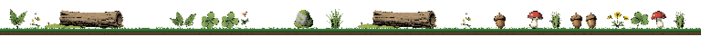

  

hey, i'm **bluecheze**. 16, been writing code for a while.

i build small open source tools, and every one of them gets its own pixel art.

<h3></h3>

**[larder](https://github.com/bluecheze/larder)**: your own drive, on your own computer. files come down from your host when you open them. macOS, Linux and Windows. being built in the open.

