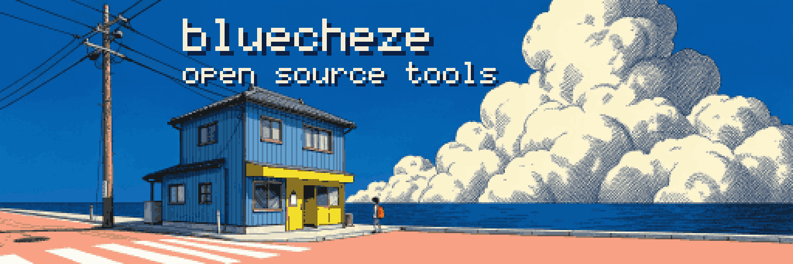

  

small open source tools. all MIT, and each one gets its own pixel art.

### tools

nothing shipped yet. the first one is on its way.

banner: painted locally with FLUX.2 klein 4B (<code>art/generate.sh</code>), then turned into pixel art by <code>python3 art/banner.py</code>.
